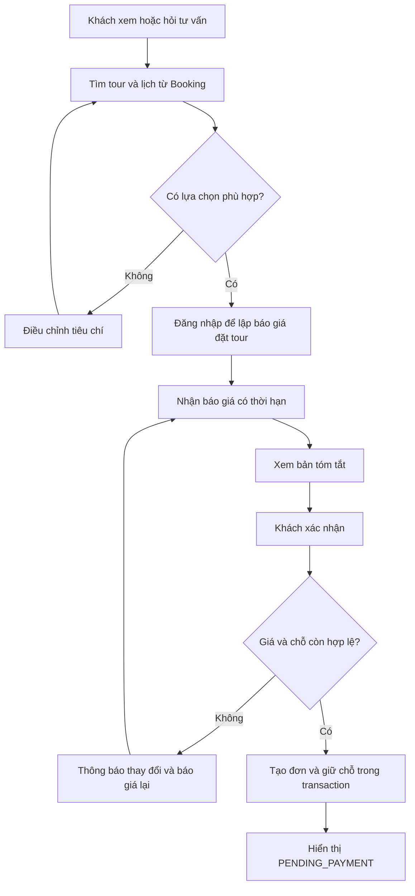
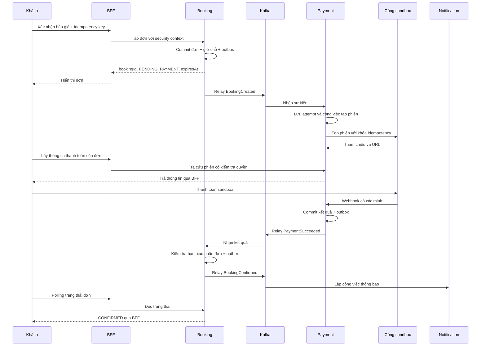
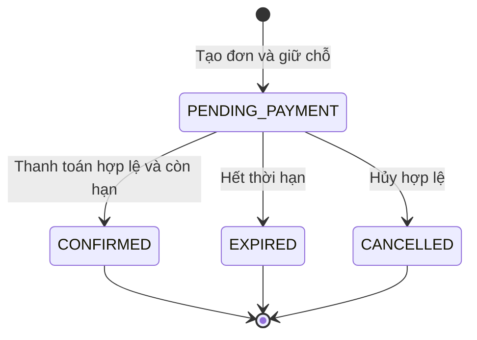

# Luồng sử dụng và trạng thái

Trạng thái: **đề xuất thiết kế**. Các biểu đồ dưới đây mô tả baseline ở [03-BUSINESS-RULES](03-BUSINESS-RULES.md), không phải luồng đã chạy.

## 1. Tìm tour đến khi có đơn

Việc khách chưa thanh toán ngay không khiến request HTTP chờ toàn bộ quy trình. Sau khi tạo đơn, frontend hiển thị thời hạn giữ chỗ và chờ phiên thanh toán. Nếu Payment chưa xử lý, hiện thông báo đang chuẩn bị; không tạo link thanh toán từ giá trị đoán.

## 2. Luồng thành công giữa các thành phần

Các bước gọi cổng thanh toán/gửi email nằm ngoài transaction DB. Consumer có thể commit offset sau khi đã ghi công việc bền vững; worker tiếp tục xử lý. Không giữ transaction DB mở trong lúc chờ nhà cung cấp.

## 3. Trạng thái booking

| Từ                | Tác nhân/điều kiện                       | Sang            | Tác động bắt buộc                                          |
| ----------------- | ---------------------------------------- | --------------- | ---------------------------------------------------------- |
| Chưa có           | Báo giá hợp lệ, đủ chỗ, request hợp lệ   | PENDING_PAYMENT | Giữ chỗ, snapshot, outbox cùng transaction                 |
| PENDING_PAYMENT   | PaymentSucceeded hợp lệ, còn hạn         | CONFIRMED       | HELD → CONFIRMED, phát sự kiện                             |
| PENDING_PAYMENT   | Hết hạn                                  | EXPIRED         | HELD → RELEASED, phát sự kiện                              |
| PENDING_PAYMENT   | Khách hủy hợp lệ                         | CANCELLED       | HELD → RELEASED, phát sự kiện                              |
| PENDING_PAYMENT   | Một attempt thanh toán thất bại          | PENDING_PAYMENT | Giữ đến hạn; cho thử lại nếu policy và trạng thái cho phép |
| EXPIRED/CANCELLED | Nhận thanh toán thành công muộn          | Giữ nguyên      | Tạo nghĩa vụ bù trừ; không giữ lại chỗ                     |
| CONFIRMED         | Callback/sự kiện trùng cùng payment      | Giữ nguyên      | Không tăng số chỗ hoặc tạo tác động mới                    |
| CONFIRMED         | Một payment khác thành công cho cùng đơn | Giữ nguyên      | Đối soát khoản thu dư và yêu cầu bù trừ                    |

Hủy sau CONFIRMED chưa nằm trong máy trạng thái baseline cho đến khi Q-08 được chốt. Trạng thái hoàn thành chuyến/no-show/đổi lịch cũng chưa được định nghĩa; không thêm enum rồi coi nghiệp vụ đã tồn tại.

Terminal ở biểu đồ là kết thúc luồng đặt chỗ baseline, không có nghĩa không còn công việc tài chính hoặc thông báo.

## 4. Payment, refund và reservation tách biệt

| Đối tượng             | Trạng thái đề xuất                                | Ý nghĩa                                                       |
| --------------------- | ------------------------------------------------- | ------------------------------------------------------------- |
| Reservation           | HELD, CONFIRMED, RELEASED                         | Một reservation không được giải phóng hai lần                 |
| Payment attempt       | CREATED, PENDING, SUCCEEDED, FAILED, UNKNOWN      | UNKNOWN yêu cầu đối soát; không tự thử lại bằng attempt mới   |
| Refund                | REQUESTED, PROCESSING, SUCCEEDED, FAILED, UNKNOWN | FAILED/UNKNOWN vẫn cần xử lý nghĩa vụ hoàn tiền               |
| Notification delivery | PENDING, SENDING, SENT, FAILED, UNKNOWN           | SENT chỉ khi có bằng chứng nhà cung cấp đã nhận theo contract |

Payment SUCCEEDED không bị ghi lại thành FAILED khi nhận callback cũ. Nếu nhà cung cấp có chuỗi sự kiện phức tạp hơn, adapter phải đối chiếu trạng thái thực và version/tham chiếu; không áp thứ tự đến mạng làm thứ tự nghiệp vụ.

## 5. Tranh chấp hết hạn và thanh toán

Booking xử lý job hết hạn và sự kiện thanh toán dưới cùng khóa đơn/reservation. Khi hai tác vụ đến đồng thời, transaction thắng quyết định trạng thái; transaction còn lại đọc lại rồi áp quy tắc tương ứng. Cả hai cùng kiểm tra giờ DB. Không dựa vào thời gian của browser hoặc thời điểm Kafka nhận message để gia hạn.

Ví dụ minh họa: đơn hết hạn lúc 10:15; cổng thu tiền lúc 10:14:59 nhưng Booking xử lý lúc 10:15:05. Baseline coi là muộn và chuyển sang bù trừ. Nếu muốn chấp nhận thời điểm thu tiền của cổng, phải chốt Q-07 và thiết kế lại khoảng chờ/giữ chỗ; không chỉ đổi một câu điều kiện.

## 6. Luồng hủy và bù trừ

Khách gửi hủy đơn chưa thanh toán → Booking kiểm tra chủ sở hữu/trạng thái → commit CANCELLED và giải phóng chỗ → phát BookingCancelled. Payment đánh dấu không còn nhận thanh toán mới và cố đóng phiên nếu cổng hỗ trợ. Nếu vẫn nhận tiền, Payment ghi nhận sự thật; Booking yêu cầu hoàn tiền bằng command có ID ổn định. Payment ghi refund rồi worker gọi cổng. Kết quả hoàn được phát bằng event và hiển thị riêng.

Không gọi đây là transaction phân tán có rollback tự động. Khi hoàn tiền lỗi, đơn vẫn CANCELLED/EXPIRED và có nghĩa vụ chưa giải quyết.

## 7. Luồng agent hỗ trợ tạo đơn

Khách nói nhu cầu → agent tìm tour → agent gọi báo giá → UI hiển thị bản tóm tắt từ dữ liệu có cấu trúc → khách đăng nhập và xác nhận hành động cụ thể → backend tiêu thụ confirmation cùng idempotency record → Booking tạo đơn → agent diễn đạt kết quả thật.

Nếu khách chỉ nói “đặt giúp tôi” khi chưa có tour/lịch/giá cụ thể, agent chưa được gọi thao tác ghi. Xác nhận ở lượt trước không áp dụng cho báo giá mới. Xem [cơ chế xác nhận](11-AI-KNOWLEDGE-AND-TOOLS.md).

## 8. Trạng thái giao diện cần có

- Loading, rỗng, lỗi kết nối và có dữ liệu là các trạng thái riêng.
- Tạo đơn xong nhưng chưa có payment session: hiển thị đang chuẩn bị thanh toán.
- Trả tiền xong nhưng Booking chưa xác nhận: hiển thị đang kiểm tra; không khẳng định thất bại.
- Đơn hết hạn nhưng có tiền đang hoàn: hiển thị cả hai trạng thái và kênh hỗ trợ.
- Chat bị ngắt khi đang tạo đơn: tra cứu operation/đơn; không làm người dùng tạo lặp.
- AI bị lỗi: vẫn có đường tìm tour và quản lý đơn thông thường.
