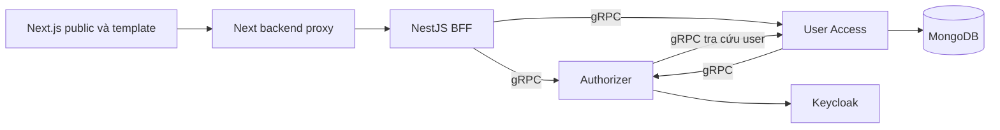
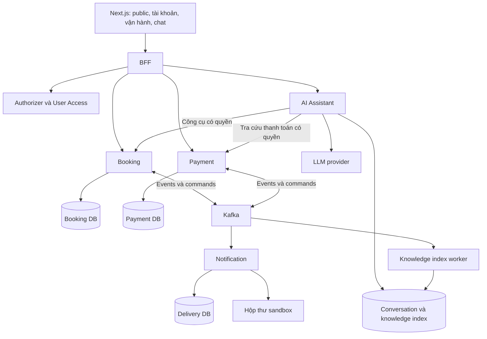

# Kiến trúc hệ thống

Trạng thái: **hiện trạng được đối chiếu + kiến trúc đích đề xuất**. Chưa tạo service, broker hoặc database mới trong phạm vi tài liệu.

## 1. Kiến trúc hiện tại



Sơ đồ biểu diễn ranh giới trong source, không khẳng định browser đã đăng nhập hoặc gọi API bảo vệ thành công. Redis phục vụ cơ chế cache xác thực hiện có; PostgreSQL/TypeORM là nền tùy chọn. Xem [kiến trúc backend hiện tại](../server/instructions/architecture.md).

## 2. Kiến trúc đích đề xuất



Index worker là tiến trình/module thuộc ai-assistant, không bắt buộc một microservice mới. AI chỉ đọc chỉ mục của mình; không truy cập trực tiếp DB Booking/Payment.

## 3. Ranh giới trách nhiệm

| Thành phần   | Sở hữu                                                                     | Không chịu trách nhiệm                                        |
| ------------ | -------------------------------------------------------------------------- | ------------------------------------------------------------- |
| BFF          | Contract HTTP, validation đầu vào, chuyển tiếp identity, tổng hợp response | Không giữ transaction đặt chỗ hoặc quyết định giá             |
| Authorizer   | Tích hợp nhà cung cấp danh tính, xác thực theo contract                    | Không quản lý số chỗ, đơn hoặc quyền bằng prompt              |
| User Access  | Hồ sơ ứng dụng, role/permission theo thiết kế đã chốt                      | Không lưu kết quả thanh toán                                  |
| Booking      | Tour, lịch, báo giá, reservation, đơn, điều phối vòng đời đặt chỗ          | Không kết luận tiền đã về dựa trên redirect của browser       |
| Payment      | Attempt, adapter nhà cung cấp, webhook, đối soát, refund                   | Không sửa reservation hoặc tự xác nhận đơn                    |
| Notification | Template thông báo, delivery job, lịch sử gửi                              | Không quyết định trạng thái booking                           |
| AI Assistant | Hội thoại, tool orchestration, retrieval, budget, đánh giá                 | Không là nguồn sự thật cho giá/quyền/chỗ/trạng thái tài chính |

Giữ tour/lịch/inventory trong Booking ở baseline để chống oversell trong transaction cục bộ. Tách inventory sau này phải có lý do và thiết kế reservation protocol; xem [ADR về ranh giới](DECISIONS/01-SERVICE-BOUNDARIES.md).

## 4. Chọn transport theo nhu cầu

| Tình huống                         | Đề xuất                            | Lý do                                                  |
| ---------------------------------- | ---------------------------------- | ------------------------------------------------------ |
| Browser đọc/ghi nghiệp vụ          | HTTP qua BFF                       | Một điểm contract và kiểm soát truy cập                |
| BFF gọi Booking/Payment            | gRPC/protobuf v1                   | Contract sinh type, deadline và metadata thống nhất    |
| AI gọi công cụ đọc/ghi             | gRPC với typed contract            | Cần kết quả xác định; không cho mô hình chọn URL tùy ý |
| Cập nhật sau một sự kiện nghiệp vụ | Kafka                              | Consumer độc lập, có thể phục hồi bằng dữ liệu đã lưu  |
| Nội dung chat trả dần              | HTTP streaming/SSE qua tuyến riêng | Không dùng Kafka làm đường truyền từng token           |
| Webhook thanh toán                 | HTTP endpoint chuyên dụng          | Xác minh body/header theo provider, ghi nhận bền vững  |

Tuyến streaming chưa tồn tại. Không áp interceptor envelope JSON hiện tại vào SSE; cần contract, proxy header, timeout và auth riêng. Không mặc định helper gRPC hiện tại hỗ trợ stream token. Những thay đổi này phải cập nhật instructions FE/BE khi thực sự triển khai.

NestJS có cơ chế gửi sự kiện bằng `emit()` và nhận bằng `@EventPattern()`. Thiết kế này dùng chúng cho integration event; request-response vẫn ở đường trực tiếp. Việc commit offset và retry phải được xác minh với transport/client được chọn, không chỉ nhìn decorator. [Tài liệu NestJS Kafka](https://docs.nestjs.com/microservices/kafka)

## 5. Tổ chức code đề xuất

```text
server/apps/
  bff/
  authorizer/
  user-access/
  booking/
  payment/
  notification/
  ai-assistant/

server/libs/
  interfaces/     Contract HTTP, gRPC và event dùng chung
  configuration/  Cấu hình kết nối và validation
  constants/      Tên contract ổn định
  ...             Các library hiện có
```

Đây là cây đích, không phải yêu cầu scaffold toàn bộ ngay. Trong mỗi app tiếp tục controller → service → repository theo instructions. Entity, repository và nghiệp vụ mới thuộc app sở hữu. Không thêm base class/generic framework chỉ để dùng chung một lần.

Contract có thể dùng chung trong monorepo nhưng phải version hóa khi service triển khai độc lập. Consumer không import service/repository/entity của producer. Thư viện event/outbox chỉ tách khi có logic dùng chung thực sự và không kéo nghiệp vụ vào hạ tầng.

## 6. Vòng đời một yêu cầu và transaction

BFF xác minh request, gắn identity và process/correlation ID. Service nghiệp vụ kiểm tra quyền trên tài nguyên và invariant ngay tại boundary của mình. Service commit dữ liệu và outbox cùng transaction. Relay gửi Kafka; consumer ghi inbox cùng thay đổi cục bộ hoặc công việc bền vững. Worker gọi dịch vụ ngoài bằng khóa ổn định và có đối soát.

Không dùng BFF làm saga coordinator giữ trạng thái trong memory. Booking điều phối vòng đời đơn bằng trạng thái DB và command bù trừ có thể chạy lại. Payment vẫn sở hữu sự thật tài chính.

## 7. Triển khai local và môi trường demo

Đề xuất Docker Compose cho dependency; app có thể chạy qua Nx trong quá trình phát triển. PostgreSQL local dùng chung instance nhưng database/user tách theo service. Kafka một broker cho demo chỉ phục vụ học luồng; không đại diện cho khả năng chịu lỗi của cluster nhiều broker.

Không bắt buộc Kubernetes, service mesh, nhiều vùng triển khai hoặc Kafka Connect trong baseline. Nếu thêm Debezium cần ADR riêng về CDC, vận hành connector, phục hồi và thứ tự sự kiện.

## 8. Các giới hạn cần làm rõ trước tích hợp

- Frontend session/refresh và chuyển tiếp auth chưa có contract hoàn chỉnh; Q-11.
- Endpoint tạo user hiện chưa gắn decorator bảo vệ; không dùng làm mẫu chính sách cho endpoint mới.
- Dịch vụ nội bộ cần xác thực workload/identity, không tin header do client gửi thẳng; Q-12.
- Dependency/adapter Kafka và LLM cần kiểm tra tương thích với phiên bản đang cài tại lúc triển khai; Q-13/Q-14.
- Bộ nhớ, CPU, ngân sách và nơi deploy chưa chốt; không đưa cam kết scale hoặc availability.

RPC nội bộ hiện tại đã chuyển sang gRPC cho Authorizer/User-access, dùng correlation metadata và deadline. Booking/Payment/AI/Kafka trong kiến trúc đích vẫn là đề xuất. Transport nội bộ chưa có TLS/service identity; Q-12 vẫn cần chốt theo môi trường triển khai.
