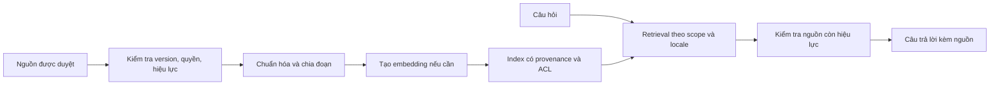

# Tri thức và công cụ của AI agent

Trạng thái: **thiết kế đề xuất**, không phải danh sách tool đã triển khai. Provider/model, framework và vector store chưa được chọn.

## 1. Nguồn dữ liệu theo loại câu hỏi

| Câu hỏi                          | Nguồn bắt buộc                                       | Không dùng làm nguồn chính thức                               |
| -------------------------------- | ---------------------------------------------------- | ------------------------------------------------------------- |
| Có tour/lịch nào phù hợp?        | API Booking, dữ liệu đã công bố                      | Tên tour do LLM tự tạo                                        |
| Giá hiện tại, còn bao nhiêu chỗ? | API giá/chỗ; quote lúc tạo đơn                       | Embedding, cache hội thoại hoặc nội dung quảng bá cũ          |
| Hủy/hoàn tiền thế nào?           | Policy được duyệt và version áp dụng cho đơn         | Blog ngoài, tài liệu hết hạn, nội dung tự sinh                |
| Đơn của tôi ra sao?              | API có xác thực và kiểm tra chủ đơn                  | Vector index dùng chung hoặc dữ liệu chat từ user khác        |
| Có thể tham quan gì?             | Nội dung đã duyệt; kiến thức tham khảo được gắn nhãn | Khẳng định dịch vụ đang mở hoặc đã được đặt khi chưa kiểm tra |

Tài liệu thiết kế trong thư mục này chứa nhiều quy tắc đề xuất. **Không nhập toàn bộ chúng làm chính sách dành cho khách.** Chỉ nguồn thương mại đã được chủ dự án duyệt và đánh dấu hiệu lực mới được xuất bản vào kho tri thức public.

## 2. Pipeline tri thức đề xuất

Nguồn nhỏ có thể bắt đầu bằng tìm kiếm văn bản và metadata; vector search là lựa chọn khi có nhu cầu và kết quả đánh giá. Không chọn database mới chỉ vì hệ thống có AI. Hybrid search/reranker cũng cần chứng minh cải thiện trên bộ câu hỏi của dự án.

## 3. Metadata và cập nhật

Document tối thiểu có sourceId, title, version, locale, visibility/ACL, approvedBy, approvedAt, effectiveFrom, effectiveTo, status và checksum. Chunk giữ sourceId/version, vị trí trong tài liệu và nội dung đủ ngữ cảnh. Citation trỏ nguồn được phép truy cập, không lộ đường dẫn nội bộ.

Khi nguồn đổi: tạo version mới → index vào vùng staging → đánh giá/kiểm tra → chuyển active version → loại bản cũ khỏi retrieval. Nếu nguồn bị thu hồi, đánh dấu không hợp lệ tại thời điểm đọc ngay cả khi xóa vector còn trễ. Không chỉ dựa vào job xóa index chạy nền.

Event TourPublished/Updated/Unpublished có source ID/version, không nhất thiết chứa toàn bộ tài liệu. Worker có quyền đọc nguồn đúng version, xử lý idempotent và ghi indexedVersion. Nếu không lấy được version yêu cầu hoặc phát hiện gap, đối soát nguồn hiện tại thay vì khôi phục bản đã thu hồi.

Policy chưa có dịch vụ sở hữu trong source. Baseline đề xuất tài liệu version hóa được duyệt và nhập bằng công cụ vận hành có audit; tự động hóa policy publishing cần quyết định Q-19, không giả định có CMS.

## 4. Retrieval và citation

Trước retrieval xác định scope user/public và locale. Lọc quyền trước khi nội dung vào prompt; sau retrieval kiểm tra lại ACL/hiệu lực để tránh cache hoặc index cũ làm lộ dữ liệu. Dữ liệu đơn cá nhân truy cập bằng tool, không đưa vào chỉ mục dùng chung.

Số chunk, kích thước và ngưỡng phù hợp chọn bằng evaluation. Khi không đủ căn cứ, trả trạng thái insufficient_evidence; không bắt mô hình luôn trả câu trả lời. Citation phải tham chiếu chunk/source thực sự được dùng và còn quyền truy cập.

Với đơn cũ, policyVersion trong snapshot là căn cứ. Nếu policy đã ngừng áp dụng cho đơn mới nhưng vẫn cần cho đơn cũ, retrieval phải đọc kho lịch sử có quyền tương ứng; không thay bằng policy mới nhất.

## 5. Tool catalog đề xuất

| Tool                         | Input cho mô hình                                           | Output tối thiểu                                               | Quyền/tác động                             |
| ---------------------------- | ----------------------------------------------------------- | -------------------------------------------------------------- | ------------------------------------------ |
| search_tours                 | Điểm đến, khoảng ngày, nhu cầu, số khách, ngân sách, locale | Tour ID, tên, tóm tắt, điều kiện lọc và phân trang             | Public; chỉ tour công bố                   |
| get_tour_details             | tourId, locale                                              | Nội dung, lịch, thông tin cần hỏi tiếp                         | Public                                     |
| check_departure_availability | departureId, cơ cấu khách                                   | Khả năng đáp ứng, checkedAt, điều kiện                         | Public; chưa giữ chỗ                       |
| search_policies              | query, locale, policyVersion khi đã được backend cho phép   | Đoạn trích, source/version, hiệu lực                           | Public hoặc theo phạm vi đơn đã xác thực   |
| create_booking_quote         | departureId, cơ cấu khách                                   | quoteId, priceLines, total, currency, expiresAt, policyVersion | User đã đăng nhập; tạo quote, chưa giữ chỗ |
| prepare_booking_action       | quoteId, dữ liệu khách tối thiểu theo schema                | actionId, bản tóm tắt, hạn xác nhận                            | Tạo preview; chưa tạo booking              |
| get_my_booking               | bookingId                                                   | Snapshot và trạng thái đã lọc                                  | Backend kiểm tra owner từ context          |
| get_my_payment_status        | bookingId                                                   | Trạng thái session/payment/refund được phép xem                | Không trả credential/raw provider payload  |

Không có `userId`, role, SQL, URL tùy ý hoặc tên service trong input do model cung cấp. Identity, service credential, correlationId và deadline được runtime gắn ngoài schema của mô hình. Bộ lọc dữ liệu phải có giới hạn, không cho một tool đọc toàn bộ hồ sơ người dùng.

## 6. Đường thực hiện thao tác ghi

Baseline đề xuất model chỉ chuẩn bị action. Endpoint xác nhận của UI là đường kích hoạt thực thi, tránh để model diễn giải một câu “đồng ý” mơ hồ thành quyền ghi.

1. prepare_booking_action kiểm tra quote và tạo action gắn với principal/conversation, canonical request hash, quoteVersion, expiresAt.
2. UI render summary từ response có cấu trúc của backend, không lấy giá/lịch từ đoạn văn mô hình.
3. Khách bấm xác nhận; backend xác minh phiên, quyền, CSRF/session policy, action và thời hạn.
4. Trong transaction AI DB, tạo operation ID ổn định và đánh dấu confirmation đã tiêu thụ/gắn operation. Gửi lại cùng confirmation trả operation cũ.
5. Worker/runtime gọi Booking bằng operation ID làm idempotency key. Booking kiểm tra lại quote, quyền và số chỗ trong transaction riêng.
6. Nếu bị ngắt sau Booking commit, operation được phục hồi bằng cùng khóa hoặc truy vấn kết quả. Không tạo operation mới cho cùng confirmation.
7. Lưu kết quả và gửi UI/agent để diễn đạt. Nếu quote hết hạn/giá đổi thì kết thúc bằng conflict và tạo preview mới khi khách yêu cầu.

Đây là hai transaction cục bộ được nối bằng idempotency và công việc bền vững, không phải một transaction atomic xuyên AI và Booking.

## 7. Contract tool response

Mỗi tool trả trạng thái success, business_error hoặc unavailable; có data được validate, errorCode ổn định, retryable theo policy và correlation/operation reference khi cần. Transport exception không được chuyển thành success với data rỗng.

Các trường tiền, ID, URL và state được validate trước khi dùng để render/action. Runtime giới hạn độ dài kết quả và loại bỏ nội dung không thuộc mục đích. Nếu URL trả về dẫn tới thanh toán, phải do adapter đáng tin cậy tạo và qua chính sách allowlist phù hợp provider.

## 8. Prompt injection và dữ liệu không tin cậy

Văn bản người dùng, tài liệu retrieval, tên tour, ghi chú admin và tool result đều có thể chứa chỉ dẫn độc hại. Runtime không cho chúng thay tool policy, role hoặc budget. Escape/sanitize nội dung khi render; không thực thi HTML/script từ câu trả lời.

Không cấp tool HTTP tổng quát để agent tải URL do người dùng đưa. Nếu về sau cần fetch nguồn, phải thiết kế riêng phạm vi domain, chặn địa chỉ nội bộ, redirect và kiểm soát đầu ra. Baseline không cần công cụ này.

Thử nghiệm phải chứa chỉ dẫn ẩn trong nguồn và tool result, không chỉ câu “bỏ qua hướng dẫn” trong chat. Các biện pháp cần kiểm chứng theo mô hình đe dọa của ứng dụng; prompt tự nó không phải security boundary. [OWASP Prompt Injection Prevention](https://cheatsheetseries.owasp.org/cheatsheets/LLM_Prompt_Injection_Prevention_Cheat_Sheet.html)

## 9. Kiểm soát chi phí và dữ liệu gửi ra ngoài

Chỉ gửi các field cần cho câu trả lời tới LLM. API key, auth token, webhook signature và toàn bộ hồ sơ thanh toán không được vào prompt. Mask hoặc bỏ PII không cần thiết; log metadata tool thay vì raw arguments.

Embedding cần budget theo số tài liệu/version; index lại bằng checksum để tránh trả phí lặp không cần thiết. Chọn chính sách lưu request của provider, vị trí dữ liệu và retention sau khi có provider cụ thể tại Q-14/Q-18. Chưa có căn cứ để khẳng định provider không lưu hoặc không dùng dữ liệu.
