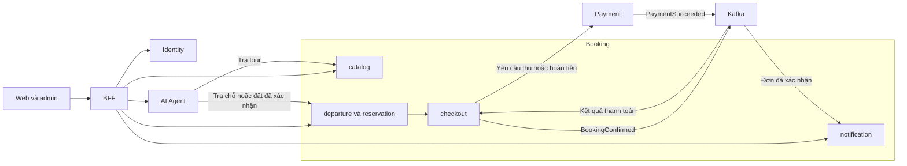

# Bản đồ backend

Backend có năm app Nx. BFF đang phục vụ HTTP, Identity quản lý hồ sơ và vai trò qua gRPC. Booking, Payment và AI Agent đã có entrypoint gRPC và các module Nest cho nghiệp vụ. Phần nghiệp vụ, Kafka, Saga và kết nối mô hình AI dưới đây là thiết kế để thảo luận.

Sơ đồ dưới đây thể hiện luồng đích. Mũi tên gRPC biểu thị một lời gọi cần kết quả ngay. Sự kiện Kafka cho phép bên nhận tiếp tục xử lý sau khi bên phát đã ghi nhận thay đổi.

## Bên trong mỗi service

Booking, Payment và AI Agent đã đăng ký tất cả module trong bảng với `AppModule` của từng app. Mỗi module có file `<module>.module.ts` và bốn thư mục `controllers/`, `mappers/`, `repositories/`, `services/` theo mẫu Identity. Các module nghiệp vụ có controller, service và repository dạng khung. Thư mục chưa có mã dùng `.gitkeep` để xuất hiện trong Git. Ba app đang lắng nghe gRPC với proto chỉ khai báo tên package. Khi thêm RPC đầu tiên cho một app, sinh lại contract và bỏ tùy chọn `registerPackage: false` trong `src/main.ts` của app đó để Nest đăng ký package. BFF và Identity hiện có `auth`, `user` và `role`; các module tiếp theo của hai app này vẫn là đề xuất.

| App và cổng mặc định   | Module                                                                    | Trách nhiệm và dữ liệu sở hữu                                                                                                                                                                                                                 |
| ---------------------- | ------------------------------------------------------------------------- | --------------------------------------------------------------------------------------------------------------------------------------------------------------------------------------------------------------------------------------------- |
| `bff` · HTTP 3300      | `auth`, `user`, `role`; tiếp theo là `catalog`, `booking`, `notification`, `chat` | Nhận request web/admin, kiểm tra quyền, chuyển danh tính caller và tổng hợp response. Ví dụ trang chi tiết lấy nội dung tour và ngày còn chỗ qua Booking.                                                                                     |
| `identity` · gRPC 5101 | `auth`, `user`, `role`                                            | Identity sở hữu thông tin đăng nhập, hồ sơ, vai trò và phiên trong MongoDB. Identity cấp JWT qua gRPC. BFF tự xác minh JWT và đọc quyền từ token.                                                                                           |
| `booking` · gRPC 5103  | `catalog`, `departure`, `reservation`, `checkout`, `notification`         | Catalog quản lý tour, điểm đến, lịch trình và chính sách. Departure quản lý chuyến, giá và sức chứa. Reservation lưu đơn và lượt giữ chỗ. Checkout điều phối Saga. Notification quản lý hộp thư, trạng thái đã đọc, kênh gửi và việc gửi lại. |
| `payment` · gRPC 5104  | `transaction`, `refund`, `provider`                                       | Transaction theo dõi số tiền, tiền tệ, mã tham chiếu và trạng thái giao dịch. Refund theo dõi yêu cầu và kết quả hoàn. Provider tích hợp cổng thanh toán, xác minh chữ ký callback và đối soát.                                               |
| `ai-agent` · gRPC 5106 | `conversation`, `agent`, `tools`                                          | Conversation lưu hội thoại theo người dùng. Agent dựng ngữ cảnh, gọi mô hình và chọn công cụ được phép. Tools gọi Booking để tìm tour, tra giá/chỗ và tạo yêu cầu đã được khách xác nhận.                                                     |

Ví dụ với một tour Hà Giang, module `catalog` của Booking sở hữu lịch trình ba ngày. Module `departure` sở hữu chuyến ngày cụ thể, giá của chuyến và hai chỗ khách muốn giữ. Payment sở hữu giao dịch tương ứng với số tiền của đơn. Khi tour đổi nội dung hoặc giá cho các chuyến sau, Booking vẫn đọc được giá đã chốt của đơn cũ.

## Đọc bộ khung trong repo

1. Mở [điểm khởi động Booking](../apps/booking/src/main.ts) và [AppModule](../apps/booking/src/app/app.module.ts) để xem cách app lắng nghe gRPC và đăng ký các module nghiệp vụ.
2. Khi triển khai nghiệp vụ đầu tiên, bổ sung xử lý trong module tương ứng theo [module user đang chạy trong Identity](../apps/identity/src/app/modules/user/user.module.ts). Ví dụ, giữ chỗ cần controller nhận lệnh, service áp dụng điều kiện và repository ghi đơn cùng số chỗ. Dữ liệu và quy tắc nằm trong app sở hữu nghiệp vụ.

## Luồng đặt tour qua AI và thanh toán dự kiến

| Khi nào                              | Bên xử lý                                                                            | Kết quả                                                                                                                                                                                                              |
| ------------------------------------ | ------------------------------------------------------------------------------------ | -------------------------------------------------------------------------------------------------------------------------------------------------------------------------------------------------------------------- |
| Khách hỏi tour và giá cho hai người  | BFF gọi AI Agent. Agent tra tour và chỗ qua gRPC của Booking                         | Khách thấy lịch trình, ngày đi, giá và số chỗ tại thời điểm hỏi.                                                                                                                                                     |
| Khách xác nhận ngày, số người và giá | Booking nhận cùng lệnh đặt chỗ từ web hoặc công cụ của agent                         | Kiểm tra danh tính, giá và tồn chỗ. Ghi đơn chờ thanh toán cùng lượt giữ chỗ trong một giao dịch cục bộ. Giá thay đổi thì yêu cầu khách xác nhận lại.                                                                |
| Cần thu tiền                         | Checkout của Booking gửi yêu cầu tạo giao dịch cho Payment                           | Payment dùng mã yêu cầu để tránh tạo hai giao dịch khi retry. Webhook từ nhà cung cấp đi qua cổng HTTP và được Payment xác minh trên dữ liệu gốc trước khi ghi nhận.                                                 |
| Thanh toán thành công                | Payment phát `PaymentSucceeded` qua Kafka. Booking xử lý theo trạng thái lưu của đơn | Nếu lượt giữ còn hiệu lực, xác nhận đơn và phát `BookingConfirmed`. Module `notification` trong Booking nhận sự kiện để tạo thông báo và gửi tin.                                                                    |
| Hết hạn hoặc thanh toán đến muộn     | Checkout xử lý hết hạn và kết quả thanh toán bằng cập nhật có điều kiện              | Trả chỗ đúng một lần. Nếu tiền đã thu sau khi chỗ được giải phóng, phương án đề xuất là yêu cầu hoàn, theo dõi đến khi Payment xác nhận thành công hoặc cần đối soát. Chính sách hoàn cụ thể cần chốt với nghiệp vụ. |

Kafka phục vụ chuyển sự kiện giữa các app. Khi triển khai, mỗi service ghi thay đổi và bản ghi sự kiện chờ phát (outbox) trong cùng giao dịch. Dùng `bookingId` để liên kết luồng, `eventId` để nhận diện sự kiện lặp. Consumer ghi dấu đã xử lý cùng thay đổi nghiệp vụ. Yêu cầu thu hoặc hoàn tiền cần mã chống lặp riêng tại cổng thanh toán. Trạng thái Saga được lưu bền trong Booking để có thể tiếp tục sau khi tiến trình khởi động lại.

Agent chỉ nhận kết quả từ các công cụ đã đăng ký và chuyển quyền của người đang thao tác. Nội dung chat không đủ để xác nhận đã thu tiền, cấp quyền quản trị hoặc ghi đè số chỗ. Tìm tour và tra giá có thể thực hiện ngay. Lệnh tạo đơn cần xác nhận của khách gắn với chuyến, giá và số người cụ thể.

## Cấu hình và seed

Booking, Payment và AI Agent dùng cùng mẫu cấu hình với Identity. `src/configuration/index.ts` khai báo `GRPC_SERV`, `APP_CONFIG` và cấu hình database. `src/main.ts` chọn địa chỉ lắng nghe bằng `grpcServerOptions`.

| App      | Cấu hình database             | Biến trong `server/.env`    | Giá trị mẫu |
| -------- | ----------------------------- | --------------------------- | ----------- |
| Identity | `MONGO_CONFIG` (MongoDB)      | `IDENTITY_MONGODB_DB_NAME`  | `identity`  |
| Booking  | `TYPEORM_CONFIG` (PostgreSQL) | `BOOKING_POSTGRES_DATABASE` | `booking`   |
| Payment  | `TYPEORM_CONFIG` (PostgreSQL) | `PAYMENT_POSTGRES_DATABASE` | `payment`   |
| AI Agent | `MONGO_CONFIG` (MongoDB)      | `AI_AGENT_MONGODB_DB_NAME`  | `ai_agent`  |

Booking và Payment dùng chung `TYPEORM_HOST`, `TYPEORM_PORT`, `TYPEORM_USERNAME` và `TYPEORM_PASSWORD`. Identity và AI Agent cùng lấy địa chỉ MongoDB từ `MONGODB_URL`.

Trên volume mới, Docker Compose khởi tạo database PostgreSQL `backend_app`. Hiện Booking và Payment chỉ nạp cấu hình. Khi bật kết nối TypeORM cho từng app, cần tạo database theo tên đã cấu hình trước khi chạy migration.

Từ thư mục `server`, chạy `pnpm exec nx run identity:seed` hoặc `pnpm exec nx run ai-agent:seed` để nạp dữ liệu vào MongoDB của app tương ứng. AI Agent hiện chưa có dữ liệu mẫu. Booking và Payment sẽ cần target seed PostgreSQL khi có dữ liệu mẫu.

## Chạy thử

Từ `server` dùng `pnpm exec nx serve booking`, thay `booking` bằng tên app cần xem. `pnpm dev-lite` chạy BFF và Identity; `pnpm dev` chạy cả năm app. Có thể đổi cổng từng service qua `<SERVICE>_SERVICE_PORT` trong [cấu hình mẫu](../.env.example). Với AI Agent, dùng `AI_AGENT_SERVICE_PORT`.
